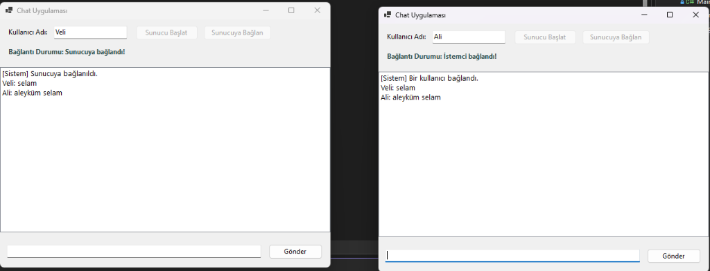

# Chat Uygulaması

Bu projede C# kullanarak basit bir mesajlaşma programı yaptım.

## Kullanılan Teknolojiler
- C#
- Windows Forms
- .NET 8

## Özellikler
- Sunucu başlatma
- Sunucuya bağlanma
- Mesaj gönderme ve alma
- Mesajları ekranda gösterme

## Çalıştırma
Visual Studio'da projeyi açıp F5'e basarak çalıştırabilirsiniz.

## Ekran Görüntüleri

